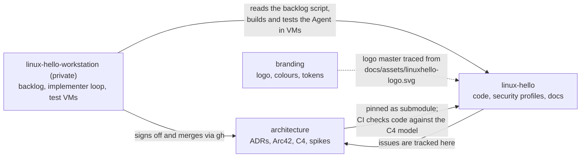
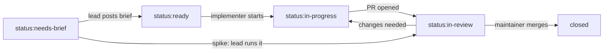

# Linux Hello: organisation overview

For members of the [LinuxHello](https://github.com/LinuxHello) GitHub organisation. Snapshot of 2026-11-08, taken from the local clones of four repositories and from GitHub with `gh`. It is not generated, so check `main` when a detail matters.

> **Keep this page inside the organisation.** It describes `linux-hello-workstation`, which is private. Invariant 8 of the project keeps machine details out of the public repositories, so this page does not belong in one.

## In one paragraph

Linux Hello is a **session credential broker for the Linux desktop**, a Windows Hello equivalent. You unlock once with face, fingerprint or PIN, and passkeys then work in browsers, native apps and Electron apps. The PIN is the root of trust (TPM 2.0 authorisation on a per-user root key). Biometrics are a shortcut, and the account password is a destructive reset. A routing policy decides per relying party whether a key is **device-bound** (TPM) or **portable** (KeePassXC). KDE Plasma comes first. Licence: LGPL-3.0-or-later. Status: **pre-alpha, nothing authenticates anyone yet.**

## The four repositories

| Repository | Visibility | What it holds | State |
| :-- | :-- | :-- | :-- |
| [`linux-hello`](https://github.com/LinuxHello/linux-hello) | public | The code: a Rust workspace of six crates, plus `security/`, `policy/`, `plasma/`, the docs vault, CI and release automation | 39 issues closed, 10 open; about 6,200 lines of Rust, 5,700 of them in the Agent |
| [`architecture`](https://github.com/LinuxHello/architecture) | public | Arc42 notes, the C4 model (`workspace.dsl`), ADRs, spikes, generated diagrams | 18 ADRs, 15 spike notes, 12 Arc42 sections (2 still gaps, 5 partly written) |
| [`branding`](https://github.com/LinuxHello/branding) | public | Brand guide, logo files generated from one master, design tokens | Draft; the logo licence and use policy are undecided |
| [`linux-hello-workstation`](https://github.com/LinuxHello/linux-hello-workstation) | **private** | The maintainer's tooling: backlog and board commands, the local implementer and its unattended loop, test-VM scripts, organisation setup | Active; every task is a `make` target |

`.github` is the fifth repository: the organisation profile.

## linux-hello: the product

### Architecture in short

Five layers: **unlock** (PAM with fprintd, Howdy, PIN), **broker** (the Agent), **interfaces** (CTAP2 over a virtual `uhid` security key for WebAuthn; the Secret Service for tokens), **routing policy**, **providers** (TPM2, KeePassXC, hardware key as fallback). Browsers see the virtual authenticator as an ordinary USB security key, which is why no browser changes are needed ([ADR-0005](https://github.com/LinuxHello/architecture/blob/main/adr/0005-provider-path.md)).

### Containers

| Path | Container | State |
| :-- | :-- | :-- |
| `crates/linuxhello-dbus` | Shared D-Bus names and types; the only coupling between containers | Small (344 lines) |
| `crates/linuxhello-agent` | Unlock and auth state, routing policy, PIN, enrolment, reset | **Built and tested**: state API on the system bus, routing policy engine, per-user policy store |
| `crates/pam-linuxhello` | PAM module: face, fingerprint and PIN in parallel | Stub |
| `crates/linuxhello-tpm-provider` | Device-bound passkeys behind the virtual authenticator | Stub; prototyped in a spike |
| `crates/linuxhello-kpxc-bridge` | Portable passkeys from KeePassXC | Stub |
| `crates/linuxhello-ctl` | CLI | Stub |
| `plasma/` | Prompts, greeter integration, enrolment, settings | README only |
| `security/` | Agent's D-Bus policy, systemd unit, AppArmor profile; Tetragon and alert rules later | Built; VM-tested |
| `policy/` | Policy schema and example | Example only |

The virtual CTAP authenticator and its `uhid` helper are not crates yet. They exist only as prototype work in [spike 0094](https://github.com/LinuxHello/architecture/blob/main/spikes/0094-virtual-ctap-end-to-end.md).

### Invariants (never break these)

1. The PIN is the root; biometrics only satisfy a TPM policy.
2. Keys sign and never leave the TPM or KeePassXC.
3. Fail closed: bad policy denies everything except the PIN, and an Agent without an enforcing AppArmor profile refuses to start.
4. No `unsafe`, except in one audited module each in the TPM provider and the PAM module.
5. Link only LGPL or permissive code; reach GPL components (KeePassXC, fprintd) across a process boundary.
6. Upstream first: no private forks of upstream projects.
7. One-way doors need an ADR: licence, names, D-Bus names (`io.github.LinuxHello.*`), crate and package names, the reset model, repository topology.
8. Public repositories carry no secrets, personal data or machine details.
9. No secrets in the agent loop.

### Quality gates

Every PR needs: rustfmt, clippy with `-D warnings`, tests, cargo-deny, cargo-audit, an `unsafe` policy check, fuzzing, rustdoc, C4-tag check, DCO sign-off and the aggregate `quality-gate`. `quality-gate` signs a Sigstore attestation, and releases are published only after that attestation verifies. Code scanning (CodeQL), dependency review and SonarQube Cloud also run. Squash merge only, signed commits on `main`. Run `make gates` locally to get exactly what CI runs.

## architecture: the decisions

### ADRs

| Status | ADRs |
| :-- | :-- |
| Accepted | 0001 monorepo with split guardrails, 0002 licence, 0003 destructive reset, 0004 agent roles, 0005 provider path, 0011 architecture repository, 0012 D-Bus names, 0014 Agent bus, 0015 face capture and enrolment, 0016 prompt hosts, 0017 browser path, 0018 user policy layer |
| Proposed, but already in use | 0006 attested gates and releases, 0007 unattended agent loops, 0008 code docs mapped to C4, 0009 self-hosted runner, 0010 Arc42 |
| Superseded | 0013 browser fallback (by 0017) |

### Spikes (Milestone 0)

Most are answered. The headline answers:

- **credentialsd is not usable** at v0.3.1, so ADR-0005 picked a virtual CTAP authenticator instead (spike 0005).
- **End to end works** for non-resident credentials without user verification: stock libfido2, Chromium 156 and Firefox 157 (spike 0094).
- **Only the system bus** is reachable in every PAM context, so the Agent serves PAM there (spike 0007, now implemented).
- **TPM root key authorisation** can change in place with tss-esapi on swtpm, if the root key is a non-primary child; hardware TPM is untested (0011).
- **RP-bound keys** work on swtpm: the key's authorisation value is HMAC(H, rpIdHash) (0119). The `uhid` helper can be confined to `/dev/uhid` (0121).
- **No extension point** exists in KDE's Users module, and the Plasma login manager and lock screen have no slot for a third-party prompt (0010, 0009).
- **RGB and IR streaming** together is unreliable on the one camera tested (0012). Trademark risk next to WINDOWS HELLO is moderate (0014, not legal advice).
- **Still open per the spike index:** spike 0033, an own browser extension and native messaging from confined browsers.

### Arc42

Sections 2, 4, 5, 8 and 9 are written. Sections 7 (deployment view) and 12 (glossary) are gaps. Parts missing elsewhere: stakeholders and quality goals (1), technical context (3), container-level runtime scenarios (6), quality tree (10), risk register (11).

### Checks on this repo

Required: `dco`, `notes` (frontmatter, relative links, no wikilinks), `dsl` (Structurizr parses). Not yet required: `diagrams` (SVGs match a fresh render), `c4-code (advisory)`.

## branding: look and feel

| Item | Value |
| :-- | :-- |
| Name in prose / in the wordmark | **Linux Hello** (two words) / **LinuxHello** ("Linux" regular, "Hello" bold) |
| Primary / ink / accent | Hello Blue `#248DE0` / Navy `#263A53`, Shadow `#1F2E45` / Beak Orange `#F8982A` |
| Type | Quicksand (display), Noto Sans (text), Noto Sans Mono (code), all SIL OFL 1.1 |
| Org avatar, app icon, favicon | `logo/linuxhello-tile.svg` |

Only `logo/linuxhello-logo.svg` is hand-supplied. Every other logo file is generated by `scripts/brand-assets.py`, so never edit the others. Run `scripts/brand-assets.py --check` before a PR. Colours live in `tokens/tokens.json`, and `tokens.css`, `colour.md` and `swatches/` follow it. Hello Blue fails contrast for text on white (3.52:1); use `blue-600` `#1C7AC5` there.

**Open:** the licence or use policy for the logo and name needs an ADR. Until then the project licence applies. A Breeze-style application icon is also missing; the tile is a stopgap.

## linux-hello-workstation: the maintainer's tooling (private)

Entry point is the `Makefile`; `make` lists tasks and `make next` shows what to pick up. [RUNBOOK.md](https://github.com/LinuxHello/linux-hello-workstation/blob/main/RUNBOOK.md) says when to run what.

| Area | Tasks |
| :-- | :-- |
| Backlog | `next`, `backlog`, `backlog-check`, `triage` (from `issues/triage.tsv`), `board` |
| Review | `signoff PR=<n>`: adds the maintainer's DCO sign-off and re-signs the branch, then the maintainer merges |
| Local implementer | `implement ISSUE=<n>`, `implement-next` (one unattended tick, run by a systemd user timer), `draft-brief`, `draft-adr`, `reset` |
| Test VMs | `vm-up`, `vm-down`, `vm-test-agent`, `vm-test-pam`, `vm-test-rpbind`, `vm-test-uhid` on Ubuntu 24.04 and 26.04 |
| Organisation setup | `org`, `repo`, `seed`, `protect`, `labels`, `security`, `sonar` (done; idempotent) |

The unattended implementer ([ADR-0007](https://github.com/LinuxHello/architecture/blob/main/adr/0007-unattended-agent-loops.md)) is **untested against a live model and a live user manager**. Its logic is tested with fakes.

## How work flows

| Role | Who | Does |
| :-- | :-- | :-- |
| Maintainer and architect | @atterdag | Owns architecture and threat model; reviews behaviour and tests, not Rust; decides and merges |
| Lead | Claude | Writes briefs, runs spikes, keeps labels and docs current, reviews PRs; never merges or releases |
| Implementer | A local model, or a contributor | Implements one issue from its brief, tests first, then opens a PR |
| Assistant | GitHub Copilot | PR summaries and review suggestions |

Every open issue has one `status:`, one `priority:` (`now`, `next`, `later`), a `container:` label and a `type:`. Dependencies are GitHub *blocked by* links. **Next** is the highest priority issue with no open blocker, lowest number first. Every commit is signed off (`git commit -s`, DCO). Architecture changes go to `architecture` first, then the code PR bumps the submodule pin.

## Where things stand

- **Done:** Agent state API and bus policy, systemd unit and AppArmor profile (passed on a real bus under an enforcing profile on Ubuntu 24.04 and 26.04); routing policy engine; per-user policy layer over D-Bus (ADR-0018); most Milestone 0 spikes.
- **Next in the code:** the TPM provider, the PAM module and the Plasma prompt. The virtual CTAP authenticator and `uhid` helper still have to become real crates.
- **Open spikes:** #120 resident keys, user presence and user verification in the virtual authenticator; #118 the authenticator on real sites. The spike index also marks spike 0033 (own browser extension) as open, although its issue is not among the open ones. Spikes #8 to #12 and #14 have written answers and sit in `status:in-review`, so they only need closing.
- **Open decisions:** crate and package names (#22, a one-way door), the logo and name licence, and the list of supported platforms for 1.0.
- **Tested on:** Ubuntu 24.04 and 26.04 only. Fedora, Arch and openSUSE wait until release is closer, because the design makes AppArmor mandatory.

## Inconsistencies worth fixing

1. **`linux-hello/AGENTS.md` still says the providers are credentialsd providers** and that passkeys work "through the credentialsd portal". ADR-0005 dropped credentialsd for the virtual CTAP authenticator, and the README already says so. The container table for `tpm-provider` and `kpxc-bridge` repeats the old wording.
2. **ADRs 0006 to 0010 are still "proposed"** although the repository follows them (attested gates, Arc42, C4 code tags, the unattended loop). Accept them or say why not.
3. **The ADR index** lists ADR-0018 before ADR-0014.
4. **The `architecture` README** says the `diagrams` check is not required yet; it should join the required checks once it has been green a few times.
5. **Spike issues #8 to #12 and #14** are in review with their notes already merged.

## Start here

| I want to… | Go to |
| :-- | :-- |
| Understand the design | [`architecture/arc42/README.md`](https://github.com/LinuxHello/architecture/blob/main/arc42/README.md), then the ADR index |
| See the model | [`architecture/workspace.dsl`](https://github.com/LinuxHello/architecture/blob/main/workspace.dsl) and the SVGs in `diagrams/` |
| Build and test | [`linux-hello/README.md`](https://github.com/LinuxHello/linux-hello#build): clone with `--recurse-submodules`, `cargo build --workspace`, `make gates` |
| Pick up work | `make next`, or [`docs/project/backlog.md`](https://github.com/LinuxHello/linux-hello/blob/main/docs/project/backlog.md) |
| Rules for coding agents | [`AGENTS.md`](https://github.com/LinuxHello/linux-hello/blob/main/AGENTS.md) |
| Report a vulnerability | Privately, per [`SECURITY.md`](https://github.com/LinuxHello/linux-hello/blob/main/SECURITY.md); never in a public issue |
| Make a Linux Hello visual | [`branding/README.md`](https://github.com/LinuxHello/branding) |
| Run the maintainer tooling | [`RUNBOOK.md`](https://github.com/LinuxHello/linux-hello-workstation/blob/main/RUNBOOK.md) |
