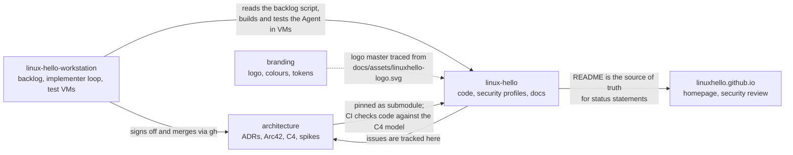
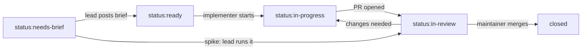

# Linux Hello: organisation overview

For members of the [LinuxHello](https://github.com/LinuxHello) GitHub organisation. Snapshot of 2026-11-23, taken from the local clones of the repositories and from GitHub with `gh`. It is not generated, so check `main` when a detail matters.

> **Visibility.** On 2026-11-23 `gh` reports this repository (`.github-private`) and `linux-hello-workstation` as public, although both READMEs still call them private. GitHub shows this page on the organisation page to members only, but while the repository is public anyone can read the file. This page therefore holds no secrets and no machine details (invariant 8); keep it that way until the maintainer has decided what stays member-only.

## In one paragraph

Linux Hello is a **session credential broker for the Linux desktop**, a Windows Hello equivalent. You unlock once with face, fingerprint or PIN, and passkeys then work in browsers, native apps and Electron apps. The PIN is the root of trust (TPM 2.0 authorisation on a per-user root key). Biometrics are a shortcut, and the account password is a destructive reset. A routing policy decides per relying party whether a key is **device-bound** (TPM) or **portable** (KeePassXC). KDE Plasma comes first. Licence: LGPL-3.0-or-later. Status: **pre-alpha**: no releases, no external audit, and a first prototype that unlocks `sudo` with a PIN or a fingerprint. Passkeys in the browser exist only as a prototype outside the repository.

## The repositories

| Repository | What it holds | State |
| :-- | :-- | :-- |
| [`linux-hello`](https://github.com/LinuxHello/linux-hello) | The code: a Rust workspace of six crates, plus `plasma/`, `security/`, `policy/`, the docs vault, CI and release automation | 130 issues closed, 58 open; 197 pull requests merged; about 28,500 lines of Rust under `src/` of the six crates (19,100 in the Agent) and 2,000 in the Plasma crates; 681 tests pass and 22 are ignored (mostly placeholders for properties whose component is not built) |
| [`architecture`](https://github.com/LinuxHello/linux-hello-architecture) | Arc42 notes, the C4 model (`workspace.dsl`), ADRs, spikes, generated diagrams | 28 ADRs (23 accepted, four proposed, one superseded), 21 spike notes, all twelve Arc42 sections written |
| [`branding`](https://github.com/LinuxHello/linux-hello-branding) | Brand guide, logo files generated from one master, design tokens | Draft; the logo licence and use policy are undecided |
| [`linux-hello-workstation`](https://github.com/LinuxHello/linux-hello-workstation) | The maintainer's tooling: backlog and board commands, the local implementer and its unattended loop, test-VM scripts, organisation setup | Active (89 commits); every task is a `make` target; reported public, README still says private |
| [`linuxhello.github.io`](https://github.com/LinuxHello/linuxhello.github.io) | The homepage and the security review with the status of each finding | Status statements must match the README of `linux-hello` |
| [`.github`](https://github.com/LinuxHello/.github) | The public organisation profile, `SECURITY.md`, issue and pull request templates, the DCO check | Refreshed with this overview |
| `.github-private` | This page | Reported public |

## linux-hello: the product

### Architecture in short

Five layers: **unlock** (PAM with fprintd, Howdy, PIN), **broker** (the Agent), **interfaces** (CTAP2 over a virtual `uhid` security key for WebAuthn; the Secret Service for tokens), **routing policy**, **providers** (TPM2, KeePassXC, hardware key as fallback). Browsers see the virtual authenticator as an ordinary USB security key, which is why no browser changes are needed ([ADR-0005](https://github.com/LinuxHello/linux-hello-architecture/blob/main/adr/0005-provider-path.md)).

### Containers

| Path | Container | State |
| :-- | :-- | :-- |
| `crates/linuxhello-dbus` | Shared D-Bus names and types; the only coupling between containers | Built (1,100 lines) |
| `crates/linuxhello-agent` | Unlock and auth state, routing policy, PIN, enrolment, reset | **Built and tested**: state API on the system bus, routing policy engine, per-user policy layer, the PIN (Argon2id, checked by the TPM, per-user lockout), fingerprint through fprintd and face through Howdy, status interface, audit records, finger enrolment and the reset after a forgotten PIN |
| `crates/pam-linuxhello` | PAM module: face, fingerprint and PIN in parallel | **Built and tested** in VMs: the contexts login, unlock, `sudo` and session; the account password stays in charge when Linux Hello is unavailable; a remote session is refused |
| `crates/linuxhello-tpm-provider` | The one program that talks to the TPM: a user's root key, check and change of the PIN | Built; tested on a software TPM only |
| `crates/linuxhello-kpxc-bridge` | Portable passkeys from KeePassXC | Stub (13 lines) |
| `crates/linuxhello-ctl` | CLI | Built: `pin set`, `pin change`, `status`, `doctor`, `policy show` and `reset`, `notify` |
| `plasma/` | The Agent Link (a Rust QML plugin), the Auth Prompt (QML), Linux Hello's own login screen for greetd, the sign-in notification | Built and tested in the desktop test VM; the System Settings page is not built |
| `security/` | Bus policy, systemd units, AppArmor profiles of the Agent and the TPM provider, polkit rules; Tetragon and alert rules later | Built; VM-tested |
| `policy/` | Policy schema and example | Example only |

The virtual CTAP authenticator and its `uhid` helper are not crates yet. They exist only as prototype work in [spike 0094](https://github.com/LinuxHello/linux-hello-architecture/blob/main/spikes/0094-virtual-ctap-end-to-end.md).

### Invariants (never break these)

1. The PIN is the root; biometrics only satisfy a TPM policy.
2. Keys sign and never leave the TPM or KeePassXC.
3. Fail closed: bad policy denies everything except the PIN, and an Agent without an enforcing AppArmor profile refuses to start.
4. No `unsafe`, except in one audited module each in the PAM module (`entry.rs`) and the Agent Link (`bridge.rs`, the cxx-qt bridge); a CI check enforces the allow-list.
5. Link only LGPL or permissive code; reach GPL components (KeePassXC, fprintd) across a process boundary.
6. Upstream first: no private forks of upstream projects.
7. One-way doors need an ADR: licence, names, D-Bus names (`io.github.LinuxHello.*`), crate and package names, the reset model, repository topology.
8. Public repositories carry no secrets, personal data or machine details.
9. No secrets in the agent loop.

### Quality gates

Three lists, which are not the same:

- **Attested gate** (`scripts/ci/quality-gates.txt`): `fmt`, `clippy`, `test`, `cargo-deny`, `cargo-audit`, `unsafe-policy`, `fuzz`, `docs`. `quality-gate` passes only when all of them did, and then signs a Sigstore attestation; releases are published only after it verifies.
- **Required to merge** (the ruleset of `main`): `fmt`, `clippy`, `test`, `cargo-deny`, `cargo-audit`, `fuzz`, `dco`, `quality-gate`. `main` also takes squash merges only, a linear history and signed commits, and a code-scanning (CodeQL) result.
- **Run and reported, not blocking:** `repo-hygiene`, `agent-links-no-tpm`, `confinement` and the Plasma jobs. CodeQL, dependency review and SonarQube Cloud also run.

Release tags: a second ruleset lets only repository administrators create, move or delete a tag and requires signed tags, and the signing job of a release waits for the maintainer in a protected environment (`release`). The release workflow has not run yet. `make gates` runs what CI runs, locally.

## architecture: the decisions

### ADRs

| Status | ADRs |
| :-- | :-- |
| Accepted (23) | 0001 monorepo with split guardrails, 0002 licence, 0003 destructive reset, 0004 agent roles, 0005 provider path, 0006 attested gates and releases, 0008 code docs mapped to C4, 0010 Arc42, 0011 architecture repository, 0012 D-Bus names, 0014 Agent bus, 0015 face capture and enrolment, 0016 prompt hosts, 0017 browser path, 0018 user policy layer, 0020 presence and verification, 0021 how the PIN reaches the Agent and the TPM, 0022 crate and package names, 0023 the PAM module, 0024 status interface, 0026 clients reach the Agent directly, 0027 the settings page calls, 0028 how the Plasma screens reach the Agent |
| Proposed (4) | 0007 unattended agent loops, 0009 self-hosted runner, 0019 shared memory for the coding agents, 0025 one virtual key per user and session |
| Superseded | 0013 browser fallback (by 0017) |

Amendments are written into the ADR they change, dated, and marked accepted or proposed; for example ADR-0021 and ADR-0023 each gained an amendment on 2026-11-23 from the security review.

### Spikes (Milestone 0)

21 spike notes. Most are answered. The headline answers:

- **credentialsd is not usable** at v0.3.1, so ADR-0005 picked a virtual CTAP authenticator instead (spike 0005).
- **End to end works** for non-resident credentials without user verification: stock libfido2, Chromium 156 and Firefox 157 (spike 0094).
- **Only the system bus** is reachable in every PAM context, so the Agent serves PAM there (spike 0007, implemented).
- **TPM root key authorisation** can change in place with tss-esapi on swtpm, if the root key is a non-primary child; hardware TPM is untested (0011).
- **RP-bound keys** work on swtpm: the key's authorisation value is HMAC(H, rpIdHash) (0119). The `uhid` helper can be confined to `/dev/uhid` (0121).
- **No extension point** exists in KDE's Users module, and the Plasma login manager and lock screen have no slot for a third-party prompt (0010, 0009).
- **RGB and IR streaming** together is unreliable on the one camera tested (0012). Trademark risk next to WINDOWS HELLO is moderate (0014, not legal advice).

Open spike issues in `linux-hello`: #343 the lock screen as a Plasma shell package (in progress), #317 how a screen part finds and follows the PAM module's prompt (ready, a one-way door), #311 the greeter (answer written, in review), #177 what authenticates the presence prompt, #154 TPM cost per passkey operation on a hardware TPM, #153 face-match latency with Howdy, #142 revoking the old root-key blob on a PIN change, #138 binding the virtual device to one user and session, #136 how a session is unlocked and a biometric match tied to the TPM (the largest open question), #120 and #118 the virtual authenticator with resident keys and on real sites.

### Arc42

All twelve sections are written ([index](https://github.com/LinuxHello/linux-hello-architecture/blob/main/arc42/README.md)). A section's own *State* line says what is built and what is only decided.

### Checks on this repo

Required: `dco`, `notes` (frontmatter, relative links, no wikilinks), `dsl` (Structurizr parses). Not required: `diagrams` (SVGs match a fresh render).

## branding: look and feel

| Item | Value |
| :-- | :-- |
| Name in prose / in the wordmark | **Linux Hello** (two words) / **LinuxHello** ("Linux" regular, "Hello" bold) |
| Primary / ink / accent | Hello Blue `#248DE0` / Navy `#263A53`, Shadow `#1F2E45` / Beak Orange `#F8982A` |
| Type | Quicksand (display), Noto Sans (text), Noto Sans Mono (code), all SIL OFL 1.1 |
| Org avatar, app icon, favicon | `logo/linuxhello-tile.svg` |

Only `logo/linuxhello-logo.svg` is hand-supplied. Every other logo file is generated by `scripts/brand-assets.py`, so never edit the others. Run `scripts/brand-assets.py --check` before a PR. Colours live in `tokens/tokens.json`, and `tokens.css`, `colour.md` and `swatches/` follow it. Hello Blue fails contrast for text on white (3.52:1); use `blue-600` `#1C7AC5` there.

**Open:** the licence or use policy for the logo and name needs an ADR. Until then the project licence applies. A Breeze-style application icon is also missing; the tile is a stopgap.

## linux-hello-workstation: the maintainer's tooling

Entry point is the `Makefile`; `make` lists tasks and `make next` shows what to pick up. [RUNBOOK.md](https://github.com/LinuxHello/linux-hello-workstation/blob/main/RUNBOOK.md) says when to run what. The repository is reported public; its README still says private and names local models and paths, which is for the maintainer to reconcile.

| Area | Tasks |
| :-- | :-- |
| Backlog | `next`, `backlog`, `backlog-check`, `triage` (from `issues/triage.tsv`), `board`, `map` |
| Review | `signoff PR=<n>`: adds the maintainer's DCO sign-off and re-signs the branch, then the maintainer merges. It re-bases the branch's unsigned commits onto `main`, so a branch must hold only its own commits |
| Local implementer | `implement ISSUE=<n>`, `implement-next` (one unattended tick, run by a systemd user timer), `draft-brief`, `draft-adr`, `reset`, `models` |
| Shared memory | `memory-index`, `memory-query`, `memory-stats`, `memory-expire` (ADR-0019, proposed) |
| Test VMs | `vm-up`, `vm-down`, `vm-test-agent`, `vm-test-pin`, `vm-test-pam-sudo`, `vm-test-fingerprint`, `vm-test-provider`, `vm-test-pam`, `vm-test-greetd`, `vm-desktop`, `vm-test-greeter`, `vm-test-rpbind`, `vm-test-uhid` on Ubuntu 24.04 and 26.04 |
| Organisation setup | `org`, `repo`, `seed`, `protect`, `labels`, `security`, `sonar` (done; idempotent) |

ADR-0007 (the unattended implementer) is still proposed.

## How work flows

| Role | Who | Does |
| :-- | :-- | :-- |
| Maintainer and architect | @atterdag | Owns architecture and threat model; reviews behaviour and tests, not Rust; decides and merges |
| Lead | Claude | Writes briefs, runs spikes, keeps labels and docs current, reviews PRs; never merges or releases |
| Implementer | A local model, or a contributor | Implements one issue from its brief, tests first, then opens a PR |
| Assistant | GitHub Copilot | PR summaries and review suggestions |

Every open issue has one `status:`, one `priority:` (`now`, `next`, `later`), a `container:` label and a `type:`. Dependencies are GitHub *blocked by* links. **Next** is the highest priority issue with no open blocker, lowest number first. Every commit is signed off (`git commit -s`, DCO). Architecture changes go to `architecture` first, then the code PR bumps the submodule pin.

Fix batches from a review are opened as pull requests that each branch from `main` and hold only their own commits, so that `make signoff` can rebase them. A branch that carries copies of commits already squash-merged conflicts, so it is published again as a new branch from `main`.

## The security review of 22 November 2026

An AI-assisted review of the architecture and the code found 32 findings (one high, twelve medium, nineteen low). It is not an independent audit; none has been done. The issues, the plan in #380 and the status of each finding are public: [the review](https://linuxhello.github.io/security-review.html), with its table of fixes.

At this snapshot about half of the findings are fixed and merged, about a third are in review or partly fixed, and the rest are open. What only the maintainer can do: the first real run of the release workflow on a throwaway tag, the requirement that every pull request runs the same workflows (an organisation setting), and the decisions behind the design findings (binding a key to one user, the TPM's primary key, keying the PIN history by the TPM, how a biometric match is tied to the TPM).

## Where things stand

- **Done:** the Agent with its bus policy, unit and profile (passed on a real bus under an enforcing profile on Ubuntu 24.04 and 26.04), routing policy and the per-user policy layer, the PIN chain through the TPM provider, fingerprint and face methods, the PAM module in `sudo`, the command-line tool, the Plasma login screen and prompt, and most Milestone 0 spikes.
- **In review at this snapshot:** the Agent's own check that a `sudo` or session caller is at this machine (linux-hello #410, architecture #105), the TPM's last try and abandoned requests (#413, architecture #106), the lockout clock and the provider watchdog (#409), fuzz targets for the provider's wire format (#412), and the status text of this overview, the README, the homepage and the profile (#411, #414, site #8 and #9, `.github` #7).
- **Next in the code:** the virtual CTAP authenticator and `uhid` helper have to become real crates (spikes #118, #120, #138), the Plasma lock screen (#343, #317), the System Settings page, a hardware TPM (#154, #210), and Howdy in a helper unit with its own profile (#272, #141).
- **Open decisions:** the logo and name licence, the platforms supported for 1.0, and the design decisions listed above. Crate and package names are decided (ADR-0022).
- **Tested on:** Ubuntu 24.04 and 26.04 only. Fedora, Arch and openSUSE wait until release is closer, because the design makes AppArmor mandatory.

## Inconsistencies worth fixing

1. **Visibility.** `linux-hello-workstation` and `.github-private` are reported public, but their READMEs say private, and the workstation README says it stays private because it names local models and paths.
2. **ADR-0007 and ADR-0009 are still "proposed"** although the workstation repository follows 0007's design. Accept them or say why not.
3. **`docs/security/properties.md` is titled "planned"** although most properties have a running test; each row says which are placeholders.
4. **The three check lists differ** (attested gate, required to merge, reported only). `AGENTS.md` now says so (linux-hello #411); whether `repo-hygiene` and `agent-links-no-tpm` should be required is the maintainer's decision.
5. **The `architecture/` pin** in `linux-hello` is behind until the two ADR amendments above are merged.
6. **Spike issues in review** (#311) and issues marked `status:in-review` whose pull request is merged are cleaned by hand; `make backlog-check` shows the rest.

## Start here

| I want to… | Go to |
| :-- | :-- |
| Understand the design | [`architecture/arc42/README.md`](https://github.com/LinuxHello/linux-hello-architecture/blob/main/arc42/README.md), then the ADR index |
| See the model | [`architecture/workspace.dsl`](https://github.com/LinuxHello/linux-hello-architecture/blob/main/workspace.dsl) and the SVGs in `diagrams/` |
| Build and test | [`linux-hello/README.md`](https://github.com/LinuxHello/linux-hello#build): clone with `--recurse-submodules`, `cargo build --workspace`, `make gates` |
| Pick up work | `make next`, or [`docs/project/backlog.md`](https://github.com/LinuxHello/linux-hello/blob/main/docs/project/backlog.md) |
| Rules for coding agents | [`AGENTS.md`](https://github.com/LinuxHello/linux-hello/blob/main/AGENTS.md) |
| See what the security review found and what is fixed | [`linuxhello.github.io/security-review.html`](https://linuxhello.github.io/security-review.html) |
| Report a vulnerability | Privately, per [`SECURITY.md`](https://github.com/LinuxHello/linux-hello/blob/main/SECURITY.md); never in a public issue |
| Make a Linux Hello visual | [`branding/README.md`](https://github.com/LinuxHello/linux-hello-branding) |
| Run the maintainer tooling | [`RUNBOOK.md`](https://github.com/LinuxHello/linux-hello-workstation/blob/main/RUNBOOK.md) |
